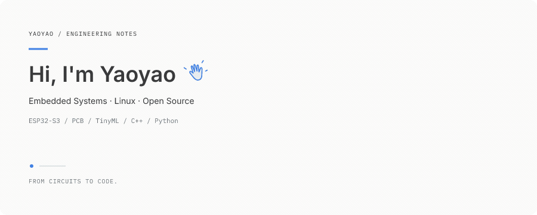

<strong>Yaoyao · Embedded systems & electronics</strong>

Exploring the space between circuits, firmware, and intelligent devices.

[View the still illustration](assets/profile-banner.svg) · [How this banner is built](docs/DEVELOPMENT.md)

### About me

I'm Yaoyao. My interests span **embedded systems, electronics engineering, Linux, TinyML, and open source**. This profile is a small, evolving workbench for those explorations.

### Toolbox

`C` · `C++` · `Python` · `ESP32` · `Linux` · `Git` · `PlatformIO` · `PCB Design`

### Featured projects

| Project                                                                        | Focus                                                                                                                |
| ------------------------------------------------------------------------------ | -------------------------------------------------------------------------------------------------------------------- |
| [Proxy Search Switcher](https://github.com/yaoyao368345/proxy-search-switcher) | My Proxy Search Switcher repository.                                                                                 |
| Embedded AI Projects                                                           | An area of exploration: TinyML and inference on embedded devices. Public project links will be added when available. |
| Open Source Contributions                                                      | A place to collect public contributions as they become available.                                                    |

Original engineering scene inspired by [ElyOffice](https://github.com/ELY-Open-Source/ElyOffice). Built with TypeScript and SVG. [Attribution & licenses](THIRD_PARTY_NOTICES.md).
